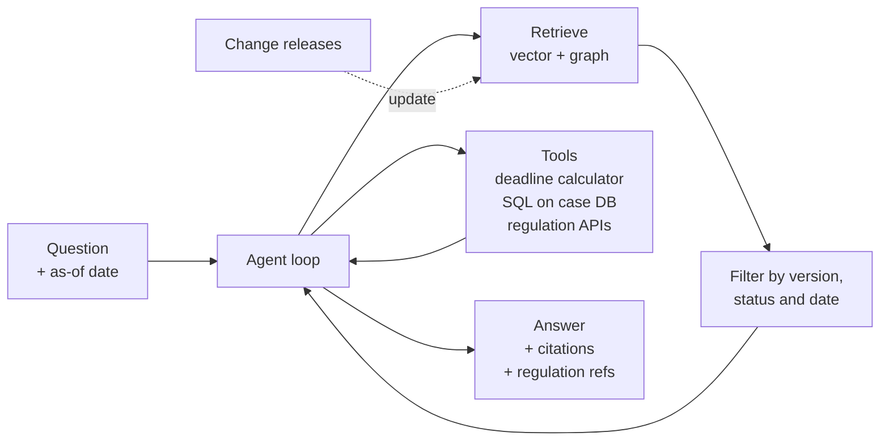

<div align="center">

# PolicyPilot

### Project 1 &nbsp;·&nbsp; `P1-POLICYPILOT`

**Build an AI assistant that a bank's disputes team can actually trust.**


[Problem Statement](PROBLEM_STATEMENT.md) &nbsp;|&nbsp; [Data Guide](docs/DATA_GUIDE.md) &nbsp;|&nbsp; [Live APIs](docs/LIVE_APIS.md) &nbsp;|&nbsp; [What to Submit](docs/SUBMISSION.md) &nbsp;|&nbsp; [Walkthrough Video](video/P1-POLICYPILOT_walkthrough.mp4) &nbsp;|&nbsp; [Video Script](video/SCRIPT.md)

</div>

<br>

## The story in 30 seconds

A customer calls the bank and says: *"I never made this purchase."*

From that moment, a federal clock starts ticking. The bank has **10 business days** to give the money back provisionally and **45 days** to finish the investigation.

The rules are written down. The problem is *where*. They are spread across hundreds of policies, procedures, wiki pages, memos and emails. Some are outdated. Some contradict each other. Some changed last week.

**Your job: build PolicyPilot, the assistant that always finds the right rule, for the right date, and proves it with a citation.**

<br>

## What you will build



| Your assistant must | Why it matters |
|:--|:--|
| Cite every answer (document, version, exact quote) | Analysts and auditors must be able to verify it |
| Answer for **any date** | A case is judged by the rules in force on the day the customer called |
| Know what is active, superseded or retired | Old versions are still lying around and still get found |
| Resolve conflicts between sources | The wiki and the policy do not always agree |
| Use tools for deadlines and data | Business-day maths and case lookups must be exact |
| Say "I don't know" when the answer is not there | A confident wrong answer is the worst outcome |

<br>

## What is inside this repo

| Folder | What you get | Size |
|:--|:--|:--|
| [`data/corpus/`](data/corpus) | **364 bank documents** from 5 systems (policies, SOPs, wiki, memos, emails) in 6 file types | 28 MB |
| [`data/registry/`](data/registry) | Document registry: ID, version, status, effective date, owner | 76 KB |
| [`data/db/`](data/db) | **Disputes case database**: 8k cases, 249k transactions, letters, chargebacks (SQLite, CSV, Postgres) | 150 MB |
| [`data/real/`](data/real) | **Real public data**: Reg E and Reg Z with full version history, Federal Register rules, CFPB guidance, enforcement orders, 56k consumer complaints, holidays | 82 MB |
| [`changes/`](changes) | **Change releases** your system must absorb (new versions, retirements, deletions) | 220 KB |
| [`eval/`](eval) | **117 public questions** with reference answers, across 10 question types | 92 KB |
| [`scripts/real/`](scripts/real) | Re-runnable scripts that fetch all the real data from live APIs | |

<br>

## Get started in 5 minutes

**1. Clone the repo**

```bash
git clone https://github.com/fnusatvik07/p1-policypilot.git
cd p1-policypilot
```

**2. Set up Python**

```bash
python -m venv .venv
source .venv/bin/activate
pip install pandas pyarrow requests lxml beautifulsoup4 pypdf holidays
```

**3. Look around**

```bash
sqlite3 data/db/harborline_disputes.sqlite ".tables"   # the case database
head -n 3 eval/questions_public.jsonl                   # sample questions
cat data/real/SUMMARY.md                                # the real public data
```

**4. Read these, in this order**

1. [Problem Statement](PROBLEM_STATEMENT.md): the full brief
2. [Data Guide](docs/DATA_GUIDE.md): every file explained
3. [What to Submit](docs/SUBMISSION.md): deliverables and grading

<br>

## What you submit

- [ ] Code repository with a README that runs end to end
- [ ] `predictions.jsonl` for all 117 public questions
- [ ] Architecture write-up
- [ ] Evaluation report (before and after each change release)
- [ ] Change feed log
- [ ] Demo video (5 to 8 minutes)

Your system will also be tested on **hidden questions**. Build for the problem, not for the test.

<br>

## Good to know

<details>
<summary><b>Is the bank real?</b></summary>
<br>
Harborline Bank, N.A. is a case-study bank created for this programme. The regulations, Federal Register rules, CFPB guidance, enforcement orders and consumer complaints are all real.
</details>

<details>
<summary><b>Which regulations are involved?</b></summary>
<br>

- **Regulation E** (12 CFR 1005): debit cards, ATM, ACH, P2P and prepaid transfers
- **Regulation Z** (12 CFR 1026.12 and 1026.13): credit card billing errors
- **Regulation CC** (12 CFR 229.10 to 229.13): funds availability, as background
</details>

<details>
<summary><b>Where do the consumer complaint stories come from?</b></summary>
<br>
From the CFPB Consumer Complaint Database. The CFPB no longer publishes consumer narratives, so the narratives here come from the last official bulk export (via a public mirror). Each row says where it came from in the <code>narrative_source</code> column.
</details>

<details>
<summary><b>Can I use any framework?</b></summary>
<br>
Yes. LightRAG is a good starting point for the knowledge graph, but any stack is fine as long as you meet the requirements in the problem statement.
</details>

<br>

## Licence and sources

Regulations, Federal Register documents and CFPB publications are US government works in the public domain. CFPB complaint data is CC0. The case-study bank material is provided for learning within this programme.
